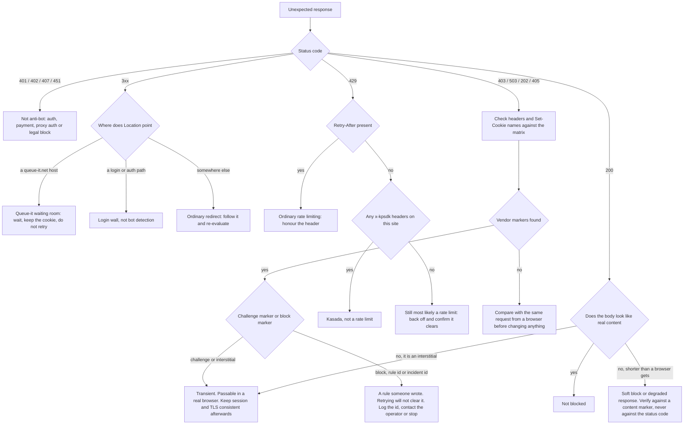

# anti-bot-field-guide

**You are blocked. By what, and what do you do about it?**

[](https://github.com/farukbagci/anti-bot-field-guide/actions/workflows/ci.yml)


🇹🇷 [Türkçe README](README.tr.md)

A diagnostic field guide to the anti-bot products you meet on the public web: how to tell them
apart from the response you already have, what each one actually inspects, and how to tell a
transient challenge from a hard ban.

This is not a bypass repo. Most of the time spent "getting past" a block is spent on the wrong
problem — people rotate proxies at a login wall, add sleeps to a proof-of-work challenge, or
rewrite a client because of a `403` that was really a malformed request. Identification first.

```bash
python detect.py https://example.com            # fetch it and say what answered
python detect.py --from-json response.json      # or replay a response you logged
```

No dependencies. Standard library only, Python 3.9+.

---

## 60 seconds to identify your blocker

Before changing anything about your client, in this order:

1. **Save the whole response.** Status, every response header, the full body. If you only kept the
   status code, you have thrown away the diagnosis.
2. **Read the `Set-Cookie` names.** Not the values — the names. `__cf_bm`, `datadome`, `_abck`,
   `_px3`, `visid_incap_*` and `aws-waf-token` each name their vendor on sight.
3. **Scan the headers for a vendor tell.** `cf-ray`, `x-iinfo`, `x-kpsdk-ct`, `x-amzn-waf-action`,
   `server: AkamaiGHost`.
4. **Read the `<title>` and the first 500 bytes of the body.** "Just a moment", "Access Denied ...
   Reference #", "Incapsula incident ID", a JSON blob with a `captcha-delivery.com` URL.
5. **Ask whether it is even an anti-bot product.** A `429` with `Retry-After`, a `401`, a redirect
   to `/login` and a `451` are all things that are not bot detection. See
   [below](#this-is-not-an-anti-bot-problem).

`detect.py` does steps 2–4 for you and prints what it matched.

---

## Identification matrix

One row per vendor. Cookie **names** matter, cookie values do not. Everything here is observable
from a single response.

| Vendor | Response headers | Cookies | Typical status | Body markers | What it actually inspects |
|---|---|---|---|---|---|
| **Cloudflare** | `cf-ray`, `cf-cache-status`, `cf-mitigated: challenge`, `server: cloudflare` | `__cf_bm`, `cf_clearance`, `__cflb` | 403, 503 (legacy JS challenge), 429 (rate rule); occasionally 200 | `Just a moment...`, `cdn-cgi/challenge-platform`, `window._cf_chl_opt`, `Attention Required! \| Cloudflare`, `Error 1020` | TLS + HTTP/2 fingerprint, header order, JS challenge with proof-of-work, per-request bot score |
| **DataDome** | `x-datadome` (not on all deployments) | `datadome` | 403 by default, **configurable per site** | JSON body with a `captcha-delivery.com` URL | TLS fingerprint, header order and casing, device-fingerprint JS payload, behavioural signals, IP reputation |
| **PerimeterX / HUMAN** | — (no reliable public header) | `_px3`, `_pxvid`, `pxcts`, `_pxhd`, `_pxCaptcha` | 403 | `_pxAppId`, JSON with `"appId":"PX…"`, `jsClientSrc`, `px-cloud.net`, `Access to this page has been denied` | JS sensor payload, behavioural biometrics (pointer and key timing), TLS fingerprint, IP reputation |
| **Akamai Bot Manager** | `server: AkamaiGHost`, `x-akamai-request-id` | `_abck`, `bm_sz`, `ak_bmsc`, `bm_sv`, `bm_mi` | 403; also **200 with degraded content** | `Access Denied`, `Reference #18.…`, `You don't have permission to access` | Sensor payload POSTed by obfuscated JS, TLS + HTTP/2 fingerprint, header order, request cadence |
| **Imperva / Incapsula** | `x-iinfo`, `x-cdn: Incapsula` | `visid_incap_*`, `incap_ses_*`, `nlbi_*`, `reese84` | 403; 200 with a JS interstitial | `Incapsula incident ID`, `_Incapsula_Resource` | JS challenge producing a signed token cookie, TLS fingerprint, IP reputation, request patterns |
| **Kasada** | `x-kpsdk-ct`, `x-kpsdk-cd`, `x-kpsdk-v`, `x-kpsdk-r` | — (state lives in headers) | **429** with a short or empty body; also 403 | `kpsdk`, script path beginning `149e9513-01fa-4fb0-aad4-566afd725d1b` | Proof-of-work executed inside an obfuscated VM, browser API probing, TLS fingerprint |
| **AWS WAF** | `x-amzn-waf-action`; `x-amz-cf-id` / `server: CloudFront` if fronted by CloudFront | `aws-waf-token` | 403 for Block; 202 or 405 for Challenge / CAPTCHA — **varies by configuration** | `awswaf.com` host in the body, `aws-waf-token` | Rule-set matching: IP sets, rate-based rules, managed rule groups; plus a JS challenge for the Challenge and CAPTCHA actions |
| **Queue-it** | `location:` to `*.queue-it.net` | `QueueITAccepted-*`, `Queue-it*` | 302, then 200 on the queue page | `queue-it.net`, `You are now in line`, `waiting room` | **Nothing about your client.** A FIFO queue keyed on an issued token |

Full weighted data, including how much each signal is worth on its own, is in
[SIGNATURES.md](SIGNATURES.md).

> These signatures change. Vendors rename cookies, move scripts to first-party paths, and let each
> customer configure status codes. Treat the table as "look here first", verify against your own
> capture, and open a PR when you find drift.

---

## Vendor detail

### Cloudflare

**How the flow works.** A request arrives, and depending on the site's configuration it is scored
and either passed, challenged or blocked. A Managed Challenge serves an interstitial from
`/cdn-cgi/challenge-platform/` which runs JS, does a small proof-of-work, probes browser APIs, and
on success sets `cf_clearance`. `__cf_bm` is a separate, shorter-lived bot-management cookie that
appears on ordinary traffic too — seeing it does not mean you were challenged.

**What commonly gets people blocked.** Almost always the TLS fingerprint. A client claiming to be
Chrome in its `User-Agent` while performing a TLS handshake that is obviously not Chrome's is the
easiest possible signal to act on. This is why a valid `cf_clearance` cookie can still return `403`
from a plain HTTP library: the cookie is fine, the handshake is not.

**Transient or hard?** Read the numeric error code in the body. `1020` is a firewall rule someone
wrote — it will not clear by retrying, from that IP or that fingerprint. `1015` is a rate-limiting
rule, and backing off genuinely clears it. `1010` is a browser-signature ban. A "Just a moment"
interstitial with no error code is a challenge, which is transient by design.

**The sane approach.** Decide which of the three you have before touching anything. For a genuine
challenge on data you are permitted to collect, the workable pattern is to pass it once in a real
browser and then keep the session *and* the TLS fingerprint consistent afterwards —
[cloudflare-bypass-toolkit](https://github.com/farukbagci/cloudflare-bypass-toolkit) is my
implementation of that. For a `1020` there is nothing to solve; contact the operator or stop.

### DataDome

**How the flow works.** A JS payload collects device and behavioural signals and posts them; the
verdict is carried in the `datadome` cookie. A rejected request is answered with a JSON body
containing a `url` field pointing at a captcha host, rather than an HTML page.

**What commonly gets people blocked.** Request rate, and header sets that are not internally
consistent — a Chrome `User-Agent` with no `Accept-Language`, headers in an order no browser sends,
or `Sec-Fetch-*` headers that do not match the navigation type being claimed.

**Transient or hard?** DataDome reacts quickly in both directions. If the interstitial appears only
after N requests and clears after a pause, you are looking at rate-driven scoring. If it appears on
the very first request from a clean IP, the trigger is your client fingerprint, not your behaviour,
and waiting will not help.

**The sane approach.** Lower concurrency first; it is free and it is the most common cause. Make
sure the headers you send are the ones the browser you claim to be would send. If neither changes
anything, this is a product doing its job — ask for API access.

### PerimeterX / HUMAN

**How the flow works.** A sensor script collects pointer movement, key timing, and device
properties, posts them, and receives `_px3`. Requests without a valid `_px3` are scored on whatever
else is available.

**What commonly gets people blocked.** The behavioural weighting is high. A client that never moves
a pointer, never scrolls, and requests pages at perfectly even intervals looks nothing like a human
session, regardless of headers.

**Transient or hard?** Block responses are usually JSON carrying `appId`, `vid` and `uuid`. Those
are per-session values, not per-request noise: if the `vid` stays the same across your retries, you
are being recognised as the same client and retrying is pointless.

**The sane approach.** Record `appId`, `vid` and `uuid` — they are exactly what a site operator
will ask for if you contact them. There is no header configuration that resolves a behavioural
verdict. For volume, API access is the realistic path.

### Akamai Bot Manager

**How the flow works.** Obfuscated JS collects a sensor payload and POSTs it to a site-specific
path; the result is reflected in `_abck`. `bm_sz` and `ak_bmsc` are set earlier in the flow and are
present on ordinary traffic.

**What commonly gets people blocked.** HTTP/2 fingerprint and header order, more than any single
header value. Akamai is also the vendor most associated with **soft responses**: a `200` with real
HTML that is quietly missing the results you asked for, or a deliberately slowed response.

**Transient or hard?** This is the one where "am I blocked?" is genuinely ambiguous, so measure
rather than guess. Compare body length and a known in-page marker against a browser session on the
same URL. A `200` that is materially shorter than the browser's, or that is missing a marker the
browser always gets, is a soft block rather than a success.

**The sane approach.** Log body length and a content marker on *every* response so that a soft
block shows up as an anomaly instead of as silently missing rows. Akamai deny pages carry a
`Reference #` — log it verbatim.

> This failure mode is not hypothetical. On one job, a transient empty page was read as "end of
> results" by pagination logic that only checked the status code. It ended the crawl early and
> silently lost 27% of the dataset. It was only found by comparing record counts against an
> expected total. Cheap to prevent, expensive to discover late.

### Imperva (Incapsula)

**How the flow works.** Two generations coexist. Classic Incapsula sets `visid_incap_<siteid>` and
`incap_ses_<n>_<siteid>` and serves scripts from `/_Incapsula_Resource?...`. Advanced Bot
Protection (the former Distil line) uses a JS interstitial that produces the `reese84` token
cookie. You may meet either or both on the same host.

**What commonly gets people blocked.** IP reputation carries real weight here — datacentre ranges
are scored harshly regardless of what your client looks like. Repeated identical requests with no
session continuity are the second common cause.

**Transient or hard?** The `Incapsula incident ID` on the block page maps to a specific rule on the
operator's side. An interstitial served on the first request from a clean IP points at your client
fingerprint; one that appears after sustained traffic points at your behaviour.

**The sane approach.** Capture the incident id — it is the only piece of information that makes a
support request actionable, and operators do respond to them. Keep a session rather than firing
independent requests.

### Kasada

**How the flow works.** A heavily obfuscated script runs a proof-of-work inside a bytecode VM and
probes browser APIs. The result travels in `x-kpsdk-*` request headers rather than in a cookie.

**What commonly gets people blocked.** Not having run the proof-of-work. There is no partial
credit: without valid `x-kpsdk-*` headers, nothing else you send matters.

**Transient or hard?** **A Kasada rejection commonly arrives as HTTP 429 with a short or empty
body.** This is the most misdiagnosed response in this guide. A `429` with no `Retry-After` and no
rate-limit headers is not necessarily rate limiting — check any endpoint of the same site for
`x-kpsdk-*` headers before adding a sleep and waiting forever.

**The sane approach.** Recognise it early, because this is the vendor where "try a bit harder" is
most reliably a waste of days. The check is executed browser work; the honest options are a real
browser engine, requesting access, or stopping.

### AWS WAF

**How the flow works.** A rule set is evaluated per request. Rules can be IP sets, rate-based
rules, or AWS managed rule groups, and the action is Allow, Block, Count, Challenge or CAPTCHA. The
Challenge and CAPTCHA actions serve an interstitial and set `aws-waf-token`.

**What commonly gets people blocked.** Usually something much less sophisticated than fingerprinting:
an IP reputation list, a rate-based rule, or a managed rule group reacting to an obviously
non-browser `User-Agent` (default library UAs are explicitly targeted by common managed rules).

**Transient or hard?** Rate-based rules are evaluated over a sliding window and genuinely clear
after it passes. An IP-set block does not. If backing off for several minutes changes nothing but a
different network works instantly, you are on a list rather than over a limit.

**The sane approach.** Try an honest, descriptive `User-Agent` and a lower rate before assuming
anything advanced is happening. Note that CloudFront headers alone say nothing about whether WAF is
even enabled — plenty of sites are fronted by CloudFront with no WAF at all.

### Queue-it

**How the flow works.** A `302` sends you to `https://<customer>.queue-it.net/?c=…&e=…&t=<your
original URL>`, you receive a token, and you wait your turn. On release you are redirected back
with a `QueueITAccepted-*` cookie.

**What commonly gets people blocked.** Nothing. You are not blocked. This is a concurrency cap for
traffic peaks — a ticket sale, a registration window — and it is in this guide only because it is
so often misread as bot detection.

**Transient or hard?** Entirely transient, by design.

**The sane approach.** Do not retry harder: a new request issues a new token and puts you back at
the end of the line. Either wait and keep the issued cookie, or schedule the work outside the peak
the waiting room exists to manage.

---

## Decision tree



---

## This is not an anti-bot problem

A large share of "I am being blocked" turns out to be one of these. Each looks like bot detection
from a distance.

| Symptom | Actually | How to confirm |
|---|---|---|
| `429` | Ordinary rate limiting | `Retry-After` or `x-ratelimit-*` headers are present, and backing off clears it. Note the Kasada exception above. |
| `403` from one network, `200` from another | Geo block or IP reputation | Same request, different network, no other change |
| `302` to `/login`, or a `200` login page where content was expected | Login wall | Read the `Location` header and the page title |
| `400` / `404` on some URLs only | Malformed request | Percent-encoding, an unencoded space, a stale path template. Compare byte-for-byte with the browser's request |
| `403` only from your client, never from `curl` | Missing or contradictory headers | Most often a missing `Accept-Language`, or `Sec-Fetch-*` headers that do not match the navigation type claimed |
| Works in the browser, fails from code, identical headers | HTTP/2 vs HTTP/1.1 | Browsers negotiate HTTP/2; many libraries default to HTTP/1.1, and the protocol version is visible to the server. Different frame ordering is a fingerprint in itself |
| Worked for an hour, then everything `403`s | Stale session | Cookies expire. `cf_clearance` and `__cf_bm` have short lifetimes; a session pinned to one IP breaks when your egress IP changes |
| `451` | Legal or geographic restriction | Nothing client-side resolves it |
| `200` with an empty or truncated body | Transient origin error, or a soft block | Compare body length against a known-good response. **Never treat a short `200` as "no more results"** |

That last row is the expensive one. A pagination loop that stops on an empty page will happily end
a crawl early and report success.

---

## Signals you should log

On every response you consider anomalous — and ideally on a sample of the normal ones too — capture
these. Storage is cheap; a diagnosis you cannot reconstruct is not.

| Field | Why |
|---|---|
| `status` | Obvious, and not sufficient on its own |
| `cf-ray` / `x-akamai-request-id` / `x-amzn-requestid` | The operator's own request id. It is what support asks for |
| `Set-Cookie` **names** (never values) | Identifies the vendor with no further work |
| `server`, `x-cdn`, `x-iinfo`, `x-kpsdk-*`, `x-amzn-waf-action`, `cf-mitigated` | The vendor tells |
| `retry-after`, `x-ratelimit-*` | Separates rate limiting from bot detection |
| `content-type` | A JSON block where you expected HTML is itself a signature |
| `content-length` and actual body length | The only way to catch soft blocks and truncation |
| `<title>` | Cheapest possible fingerprint of a challenge page |
| First ~500 bytes of body | Enough to identify a vendor after the fact, small enough to keep |
| Vendor incident id (`Incapsula incident ID`, Akamai `Reference #`, PX `uuid`) | Makes a support request actionable |
| Request timestamp and elapsed time | Slow responses before a block are a signal in themselves |
| Which egress IP or proxy was used | Otherwise you cannot correlate blocks with a network |
| Whether HTTP/1.1 or HTTP/2 was negotiated | Rules out a whole class of false leads |

Log them as one line of JSON per response. `detect(status, headers, body)` will read that record
back later without a network call — which is the point of keeping it pure. The CLI reads the same
shape directly:

```bash
python detect.py --from-json response.json
```

```json
{"status": 403,
 "url": "https://example.com/search",
 "headers": {"server": "cloudflare", "cf-ray": "0000000000000000-XXX",
             "set-cookie": ["__cf_bm=PLACEHOLDER; Path=/"]},
 "body": "<html><head><title>Just a moment...</title></head>…"}
```

Every field is optional. A record with nothing but a `status` still produces a report.

---

## detect.py

```
$ python detect.py https://example.com

URL        https://example.com/
Status     403
Body       4812 bytes
Title      Just a moment...
Vendor     Cloudflare  (confidence: high, score 26)
State      challenge

Matched signals
  - header cf-ray: 0000000000000000-XXX
  - header cf-mitigated: challenge
  - header server: cloudflare
  - cookie __cf_bm
  - body contains "cdn-cgi/challenge-platform"
  - body contains "just a moment..."
  - status 403

Next step
  Separate 'challenge' from 'firewall rule' before doing anything else. ...
```

Options:

| Flag | Effect |
|---|---|
| `--from-json FILE` | Read a saved response instead of making a request — a JSON object with `status`, `headers`, `body`, `url`. `-` reads stdin. No network at all |
| `--json` | Machine-readable output |
| `--verbose` | Also print every response header — use this when capturing a new signature |
| `--timeout N` | Seconds, default 15 |
| `--user-agent UA` | Override the User-Agent. Comparing an honest UA against a browser UA is itself a diagnostic |
| `--no-redirect` | Stop at the first response, so a `302` into a waiting room is visible |

The default `User-Agent` identifies the tool honestly. That is deliberate: this is a diagnostic
instrument, and a truthful request tells you what an operator's rules do with a truthful client.

Exit codes: `0` ran successfully, `1` the request failed, `2` bad usage.

### As a library

`detect(status, headers, body, url=None)` is pure — no I/O, no globals mutated — so you can run it
over responses from any HTTP client, or over logs you captured weeks ago.

```python
from detect import detect

result = detect(response.status_code, response.headers, response.text)

if result["state"] == "block":
    log.warning("hard block by %s: %s", result["vendor"], result["signals"])
elif result["state"] == "challenge":
    ...
```

`headers` accepts a dict, a dict of lists, a list of `(name, value)` pairs, or an
`http.client.HTTPMessage`. Names are matched case-insensitively and duplicate `Set-Cookie` headers
are all read. `body` accepts `str` or `bytes`. `status` accepts an `int`, or the string a JSON log
hands back.

Also exported: `fetch(url, timeout=15.0, user_agent=..., follow_redirects=True)` →
`(status, headers, body, urls)`, `load_record(path_or_dash)`, `format_report(result, url=None,
headers=None, verbose=False)`, `normalize_headers(headers)`, `FetchError`, and the `STATE_*`
constants.

Returned fields:

| Field | Meaning |
|---|---|
| `vendor` | Highest-scoring vendor name, or `None`. Read it together with `confidence` — a `low` here means "one weak marker", not "identified" |
| `confidence` | `high` / `medium` / `low` / `none`, from the summed signal weights |
| `score` | Summed weight of the matched signals |
| `state` | `clear` / `challenge` / `block` / `queue` / `unknown` — describes **this response**, not the site. Only a vendor at `medium` or better can set it |
| `signals` | Human-readable list of what matched |
| `candidates` | Every vendor that matched anything, sorted by score |
| `next_step` | What to do about it. Vendor-specific once a vendor is actually identified, generic while the evidence is weak |
| `hints` | Non-anti-bot explanations that fit the response, and a warning when the best match is weak |
| `title`, `body_length`, `status` | Worth logging |

The `vendor` / `state` split matters: a site can sit behind Cloudflare and still hand you a
perfectly normal page. "Cloudflare is present" and "Cloudflare is blocking me" are different
findings, and conflating them sends people down the wrong path constantly.

Adding a vendor is one entry in the module-level `VENDORS` list — no other code changes. See
[CONTRIBUTING.md](CONTRIBUTING.md).

---

## Scope and intent

This repo is for **identification and understanding**, on data you are permitted to collect.

Knowing what is in front of you is what lets you make a sensible decision: request API access,
reduce your rate, fix a malformed request, or stop. Most of the entries above end in "ask the
operator" or "slow down", because that is genuinely what the situation calls for.

Your responsibilities, not this repo's:

- **`robots.txt` and the site's terms of service.** Read them. They are yours to comply with.
- **Permission to access the data.** Being technically able to fetch something is not authorisation.
- **Rate and load.** A block is often a site telling you that you are costing it money.

Deliberately not here, and not accepted as contributions:

- CAPTCHA-solving service integration
- Credential handling, credential stuffing, or account-takeover techniques
- Paywall or access-control circumvention
- Step-by-step evasion recipes for any vendor

These products exist largely to stop fraud, credential stuffing and inventory abuse. A guide that
helps you recognise one and respond appropriately is useful to everybody; a cookbook for defeating
them is not, and is not what this is.

---

## Honest limits

- **This guide identifies; it does not solve.** For most vendors there is no configuration trick,
  and saying so plainly is more useful than pretending otherwise.
- **Signatures drift.** Cookie names, script paths and status codes change, and much of it is
  per-customer configuration. Anything marked "varies" in the tables genuinely varies. Verify
  against your own capture.
- **Absence of a signature proves nothing.** A vendor can be present and quiet. `detect.py` reports
  what it matched, never "this site is unprotected".
- **A low-confidence match is not an identification.** A single weak marker is listed as a candidate
  and labelled weak. It never sets the response state and never earns vendor-specific advice —
  "waiting room" in ordinary page copy is not a queue, and the words "just a moment" are not a
  Cloudflare challenge.
- **One response is a narrow view.** Some products only reveal themselves on the second request, on
  a POST, or on an XHR rather than a document load.
- **No behavioural or TLS analysis here.** JA3/JA4 and HTTP/2 fingerprinting are named because they
  are what these products inspect, but measuring your own fingerprint needs tooling outside a
  stdlib script.
- **Depth is uneven.** Some sections come from sustained production work, others from far fewer
  encounters. Where I am less certain the wording says so — "varies", "commonly", "field
  observation". Corrections are welcome and will be merged.

---

## Related tools

Five repos built for one pipeline, and they still read as one. This guide tells you what you are
up against, `cloudflare-bypass-toolkit` handles the most common answer, `scraper-skeleton` runs
the job, `proxy-pool` feeds it addresses, and `jsonl-qc` decides whether the result is
deliverable.

| Repo | What it does |
|---|---|
| [cloudflare-bypass-toolkit](https://github.com/farukbagci/cloudflare-bypass-toolkit) | Once the answer is Cloudflare: pass the challenge once with a real browser, then replay without one |
| [scraper-skeleton](https://github.com/farukbagci/scraper-skeleton) | The orchestration layer: bounded concurrency, retries, resume after a crash, count reconciliation |
| [proxy-pool](https://github.com/farukbagci/proxy-pool) | Feeds that runner addresses and benches the ones that got banned, with per-failure cooldowns |
| [jsonl-qc](https://github.com/farukbagci/jsonl-qc) | Validates what came out: schema, fill rates, duplicates, drift against a baseline — how you catch the 27% you silently lost |

---

## Contributing

Adding a vendor is one dict in `VENDORS` plus a test. That is the main contribution path and it is
documented step by step in [CONTRIBUTING.md](CONTRIBUTING.md). Corrections to existing signatures
are equally welcome — accuracy is the entire value of this repo.

```bash
python -m pytest tests/ -q
```

## License

MIT — see [LICENSE](LICENSE).
