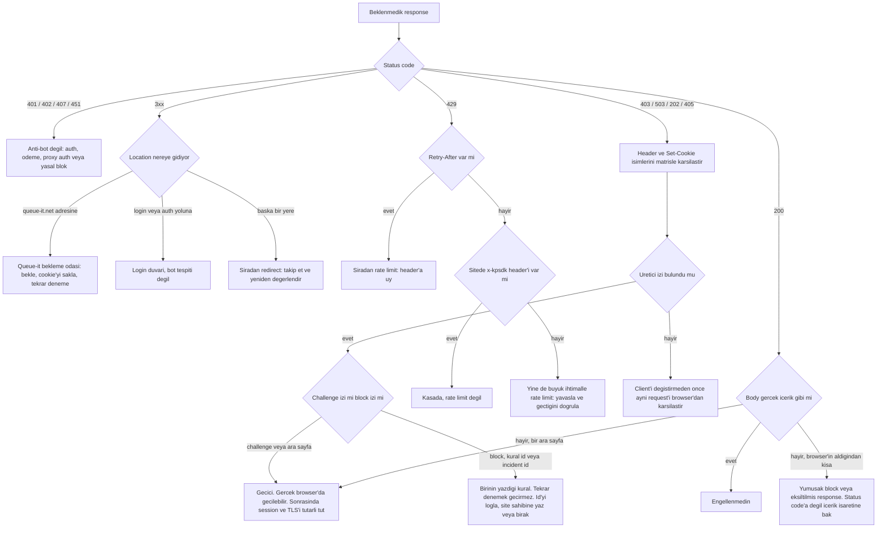

# anti-bot-field-guide

**Engellendin. Peki neye takıldın ve ne yapman gerekiyor?**

[](https://github.com/farukbagci/anti-bot-field-guide/actions/workflows/ci.yml)


🇬🇧 [English README](README.md)

Açık web'de karşılaşacağın anti-bot ürünleri için bir teşhis rehberi: elindeki response'a bakarak
hangisiyle uğraştığını nasıl anlarsın, her biri gerçekte neye bakar, ve geçici bir challenge ile
kalıcı bir ban'i nasıl ayırt edersin.

Bu bir bypass reposu değil. "Engeli aşmak" için harcanan zamanın çoğu yanlış problem üzerinde
harcanıyor — insanlar bir login duvarında proxy döndürüyor, proof-of-work challenge'ına sleep
ekliyor, ya da aslında hatalı bir request yüzünden dönen `403` için client'ını baştan yazıyor. Önce
teşhis.

```bash
python detect.py https://example.com            # iste ve cevabı kimin verdiğini söyle
python detect.py --from-json response.json      # ya da logladığın bir response'u tekrar oku
```

Bağımlılık yok. Sadece standart kütüphane, Python 3.9+.

---

## 60 saniyede engelini teşhis et

Client'ında hiçbir şeyi değiştirmeden önce, bu sırayla:

1. **Response'un tamamını kaydet.** Status, bütün response header'ları, body'nin tamamı. Elinde
   sadece status code kaldıysa teşhisi çöpe atmışsın demektir.
2. **`Set-Cookie` isimlerini oku.** Değerleri değil — isimleri. `__cf_bm`, `datadome`, `_abck`,
   `_px3`, `visid_incap_*` ve `aws-waf-token` görür görmez kendi üreticisini söyler.
3. **Header'larda üretici izi ara.** `cf-ray`, `x-iinfo`, `x-kpsdk-ct`, `x-amzn-waf-action`,
   `server: AkamaiGHost`.
4. **`<title>`'ı ve body'nin ilk 500 byte'ını oku.** "Just a moment", "Access Denied ... Reference
   #", "Incapsula incident ID", içinde `captcha-delivery.com` adresi geçen bir JSON.
5. **Karşındaki gerçekten bir anti-bot ürünü mü, onu sor.** `Retry-After` içeren bir `429`, bir
   `401`, `/login`'e giden bir redirect ve bir `451` — hiçbiri bot tespiti değil.
   [Aşağıya bak](#bu-bir-anti-bot-problemi-değil).

`detect.py` senin için 2–4. adımları yapıyor ve neyle eşleştiğini yazıyor.

---

## Teşhis matrisi

Her üretici için bir satır. Cookie **isimleri** önemli, cookie değerleri değil. Buradaki her şey
tek bir response'tan görülebilir.

| Üretici | Response header'ları | Cookie'ler | Tipik status | Body işaretleri | Gerçekte neye bakıyor |
|---|---|---|---|---|---|
| **Cloudflare** | `cf-ray`, `cf-cache-status`, `cf-mitigated: challenge`, `server: cloudflare` | `__cf_bm`, `cf_clearance`, `__cflb` | 403, 503 (eski JS challenge), 429 (rate kuralı); bazen 200 | `Just a moment...`, `cdn-cgi/challenge-platform`, `window._cf_chl_opt`, `Attention Required! \| Cloudflare`, `Error 1020` | TLS + HTTP/2 fingerprint, header sırası, proof-of-work içeren JS challenge, request başına bot skoru |
| **DataDome** | `x-datadome` (her kurulumda yok) | `datadome` | Varsayılan 403, ama **site sahibi değiştirebiliyor** | İçinde `captcha-delivery.com` adresi olan JSON body | TLS fingerprint, header sırası ve büyük/küçük harf düzeni, cihaz fingerprint'i toplayan JS, davranışsal sinyaller, IP itibarı |
| **PerimeterX / HUMAN** | — (güvenilir, herkese açık bir header yok) | `_px3`, `_pxvid`, `pxcts`, `_pxhd`, `_pxCaptcha` | 403 | `_pxAppId`, `"appId":"PX…"` içeren JSON, `jsClientSrc`, `px-cloud.net`, `Access to this page has been denied` | JS sensor verisi, davranışsal biyometri (imleç ve tuş zamanlaması), TLS fingerprint, IP itibarı |
| **Akamai Bot Manager** | `server: AkamaiGHost`, `x-akamai-request-id` | `_abck`, `bm_sz`, `ak_bmsc`, `bm_sv`, `bm_mi`, `bm_s` | 403; ayrıca **içeriği eksiltilmiş 200** | `Access Denied`, `Reference #18.…`, `You don't have permission to access` | Obfuscate edilmiş JS'in POST ettiği sensor verisi, TLS + HTTP/2 fingerprint, header sırası, request temposu |
| **Imperva / Incapsula** | `x-iinfo`, `x-cdn: Incapsula` | `visid_incap_*`, `incap_ses_*`, `nlbi_*`, `reese84` | 403; JS interstitial ile 200 | `Incapsula incident ID`, `_Incapsula_Resource` | İmzalı token cookie üreten JS challenge, TLS fingerprint, IP itibarı, request örüntüleri |
| **Kasada** | `x-kpsdk-ct`, `x-kpsdk-cd`, `x-kpsdk-v`, `x-kpsdk-r` | — (durum header'larda tutuluyor) | Kısa veya boş body ile **429**; ayrıca 403 | `kpsdk`, `149e9513-01fa-4fb0-aad4-566afd725d1b` ile başlayan script yolu | Obfuscate edilmiş bir VM içinde çalışan proof-of-work, browser API'lerinin yoklanması, TLS fingerprint |
| **AWS WAF** | `x-amzn-waf-action`; CloudFront arkasındaysa `x-amz-cf-id` / `server: CloudFront` | `aws-waf-token` | Block için 403; Challenge / CAPTCHA için 202 veya 405 — **konfigürasyona göre değişiyor** | Body'de `awswaf.com` adresi, `aws-waf-token` | Kural eşleştirme: IP listeleri, rate tabanlı kurallar, hazır kural grupları; Challenge ve CAPTCHA aksiyonlarında ayrıca JS challenge |
| **Queue-it** | `location:` bir `*.queue-it.net` adresine | `QueueITAccepted-*`, `Queue-it*` | 302, sonra kuyruk sayfasında 200 | `queue-it.net`, `You are now in line`, `waiting room` | **Client'ınla ilgili hiçbir şeye.** Verilen bir token'a bağlı FIFO kuyruk |

Her sinyalin tek başına ne kadar değerli olduğu dahil, ağırlıklandırılmış tam veri
[SIGNATURES.md](SIGNATURES.md) içinde.

> Bu imzalar değişiyor. Üreticiler cookie adlarını değiştiriyor, script'leri first-party yollara
> taşıyor, ve her müşterinin status code'ları ayrı ayrı ayarlayabilmesine izin veriyor. Tabloyu
> "önce buraya bak" diye oku, kendi capture'ınla doğrula, ve kayma fark edersen PR aç.

---

## Üretici detayları

### Cloudflare

**Akış nasıl işliyor.** Request geliyor, sitenin konfigürasyonuna göre skorlanıyor ve ya
geçiriliyor, ya challenge veriliyor, ya da engelleniyor. Managed Challenge,
`/cdn-cgi/challenge-platform/` altından bir ara sayfa sunuyor; bu sayfa JS çalıştırıyor, küçük bir
proof-of-work yapıyor, browser API'lerini yokluyor ve başarılı olursa `cf_clearance` set ediyor.
`__cf_bm` ise ayrı ve daha kısa ömürlü bir bot yönetimi cookie'si — normal trafikte de görünüyor,
yani onu görmen challenge aldığın anlamına gelmiyor.

**İnsanlar en çok neye takılıyor.** Neredeyse her zaman TLS fingerprint'ine. `User-Agent`'ında
Chrome olduğunu söyleyip Chrome'unkine hiç benzemeyen bir TLS handshake yapan bir client, üzerine
kural yazılabilecek en kolay sinyal. Geçerli bir `cf_clearance` cookie'sine rağmen düz bir HTTP
kütüphanesinden `403` almanın sebebi de bu: cookie doğru, handshake değil.

**Geçici mi kalıcı mı?** Body'deki sayısal hata koduna bak. `1020` birinin yazdığı bir firewall
kuralı — ne o IP'den ne o fingerprint'ten tekrar denemekle geçer. `1015` bir rate limit kuralı ve
gerçekten yavaşlayınca geçiyor. `1010` browser imzası bazlı bir ban. Hata kodu olmayan bir "Just a
moment" ara sayfası ise challenge'dır, yani tasarım gereği geçicidir.

**Mantıklı yaklaşım.** Hiçbir şeye dokunmadan önce elindekinin bu üçünden hangisi olduğuna karar
ver. Toplamaya izinli olduğun veride gerçek bir challenge varsa, işe yarayan yöntem challenge'ı bir
kez gerçek bir browser'da geçmek ve sonrasında hem session'ı hem TLS fingerprint'ini tutarlı tutmak
— [cloudflare-bypass-toolkit](https://github.com/farukbagci/cloudflare-bypass-toolkit) bunun benim
uygulamam. `1020` için çözülecek bir şey yok; site sahibiyle iletişime geç ya da bırak.

### DataDome

**Akış nasıl işliyor.** Bir JS yükü cihaz ve davranış sinyallerini toplayıp gönderiyor, karar
`datadome` cookie'sinde taşınıyor. Reddedilen request'e HTML sayfa yerine, içinde captcha adresini
tutan bir `url` alanı olan JSON body dönüyor.

**İnsanlar en çok neye takılıyor.** Request hızına, ve kendi içinde tutarsız header setlerine —
`Accept-Language` göndermeyen bir Chrome `User-Agent`'ı, hiçbir browser'ın kullanmadığı bir header
sırası, ya da iddia edilen navigasyon tipiyle uyuşmayan `Sec-Fetch-*` header'ları.

**Geçici mi kalıcı mı?** DataDome iki yönde de hızlı tepki veriyor. Ara sayfa ancak N request sonra
çıkıyor ve biraz bekleyince geçiyorsa, karşındaki hıza bağlı bir skorlama. Temiz bir IP'den gelen
ilk request'te bile çıkıyorsa, tetikleyen şey davranışın değil client fingerprint'in, ve beklemek
bir işe yaramaz.

**Mantıklı yaklaşım.** Önce eşzamanlılığı düşür; bedava ve en yaygın sebep bu. Gönderdiğin
header'ların, olduğunu iddia ettiğin browser'ın göndereceği header'lar olduğundan emin ol. İkisi de
bir şey değiştirmiyorsa, karşındaki ürün işini yapıyor demektir — API erişimi iste.

### PerimeterX / HUMAN

**Akış nasıl işliyor.** Bir sensor script'i imleç hareketini, tuş zamanlamasını ve cihaz
özelliklerini toplayıp gönderiyor, karşılığında `_px3` alıyor. Geçerli `_px3` taşımayan request'ler
elde ne varsa onun üzerinden skorlanıyor.

**İnsanlar en çok neye takılıyor.** Davranışsal ağırlık burada yüksek. Hiç imleç oynatmayan, hiç
scroll etmeyen ve sayfaları tam eşit aralıklarla isteyen bir client, header'ları ne olursa olsun
bir insan session'ına benzemiyor.

**Geçici mi kalıcı mı?** Block response'ları genelde `appId`, `vid` ve `uuid` taşıyan JSON. Bunlar
request başına değişen gürültü değil, session başına sabit değerler: tekrar denemelerin arasında
`vid` aynı kalıyorsa aynı client olarak tanınıyorsun ve tekrar denemenin anlamı yok.

**Mantıklı yaklaşım.** `appId`, `vid` ve `uuid`'yi kaydet — iletişime geçtiğinde site sahibinin
soracağı şey tam olarak bunlar. Davranışsal bir karara çözüm olacak bir header ayarı yok. Hacimli iş
için gerçekçi yol API erişimi.

### Akamai Bot Manager

**Akış nasıl işliyor.** Obfuscate edilmiş JS bir sensor verisi toplayıp siteye özel bir endpoint'e
POST ediyor, sonuç `_abck` içine yansıyor. `bm_sz` ve `ak_bmsc` akışın daha başında set ediliyor ve
normal trafikte de var.

**İnsanlar en çok neye takılıyor.** Tek bir header değerinden çok, HTTP/2 fingerprint'i ve header
sırası. Akamai aynı zamanda **yumuşak response** ile en çok anılan üretici: gerçek HTML dönen ama
istediğin sonuçları sessizce içermeyen bir `200`, ya da kasıtlı olarak yavaşlatılmış bir response.

**Geçici mi kalıcı mı?** "Engellendim mi?" sorusunun cidden belirsiz olduğu yer burası, o yüzden
tahmin etme, ölç. Aynı URL için body uzunluğunu ve sayfada olduğunu bildiğin bir işareti browser
session'ıyla karşılaştır. Browser'ınkinden belirgin şekilde kısa dönen, ya da browser'ın her zaman
aldığı bir işareti içermeyen bir `200` başarı değil, yumuşak bir block.

**Mantıklı yaklaşım.** **Her** response'ta body uzunluğunu ve bir içerik işaretini logla; böylece
yumuşak block sessizce eksilen satırlar olarak değil, bir anomali olarak görünür. Akamai deny
sayfaları bir `Reference #` taşıyor — olduğu gibi logla.

> Bu senaryo teorik değil. Bir işte, geçici olarak boş dönen bir sayfa, sadece status code'a bakan
> sayfalama mantığı tarafından "sonuçların sonu" diye okundu. Crawl erken bitti ve veri setinin
> %27'si sessizce kayboldu. Ancak kayıt sayısı beklenen toplamla karşılaştırıldığında fark edildi.
> Önlemesi ucuz, geç fark etmesi pahalı.

### Imperva (Incapsula)

**Akış nasıl işliyor.** İki nesil bir arada yaşıyor. Klasik Incapsula `visid_incap_<siteid>` ve
`incap_ses_<n>_<siteid>` set ediyor, script'leri `/_Incapsula_Resource?...` üzerinden sunuyor.
Advanced Bot Protection (eski Distil hattı) ise `reese84` token cookie'sini üreten bir JS ara sayfa
kullanıyor. Aynı host'ta ikisiyle de karşılaşabilirsin.

**İnsanlar en çok neye takılıyor.** Burada IP itibarının ciddi ağırlığı var — datacenter IP
blokları, client'ın nasıl görünürse görünsün sert skorlanıyor. İkinci yaygın sebep, session
sürekliliği olmadan tekrarlanan birbirinin aynı request'ler.

**Geçici mi kalıcı mı?** Block sayfasındaki `Incapsula incident ID`, site sahibinin tarafındaki
belirli bir kurala karşılık geliyor. Temiz bir IP'den gelen ilk request'te çıkan bir ara sayfa
client fingerprint'ini işaret ediyor; sürekli trafikten sonra çıkan bir ara sayfa davranışını.

**Mantıklı yaklaşım.** Incident id'yi kaydet — bir destek talebini uygulanabilir kılan tek bilgi bu
ve site sahipleri bunlara gerçekten dönüş yapıyor. Birbirinden bağımsız request'ler atmak yerine
session tut.

### Kasada

**Akış nasıl işliyor.** Ağır obfuscate edilmiş bir script, bytecode VM içinde bir proof-of-work
çalıştırıyor ve browser API'lerini yokluyor. Sonuç cookie'de değil, `x-kpsdk-*` request
header'larında taşınıyor.

**İnsanlar en çok neye takılıyor.** Proof-of-work'ü çalıştırmamaya. Kısmi puan yok: geçerli
`x-kpsdk-*` header'ların yoksa gönderdiğin başka hiçbir şeyin önemi yok.

**Geçici mi kalıcı mı?** **Kasada'nın reddi genelde kısa veya boş body ile HTTP 429 olarak
geliyor.** Bu rehberdeki en çok yanlış teşhis edilen response bu. `Retry-After` içermeyen ve
rate-limit header'ı olmayan bir `429` illa rate limit değildir — bir sleep ekleyip sonsuza kadar
beklemeden önce, aynı sitenin herhangi bir endpoint'inde `x-kpsdk-*` header'ları var mı diye bak.

**Mantıklı yaklaşım.** Erken teşhis et, çünkü "biraz daha zorlayayım" yaklaşımının en güvenilir
şekilde günler harcattığı üretici bu. Kontrol, browser'da çalıştırılan gerçek bir iş; dürüst
seçenekler gerçek bir browser engine kullanmak, erişim istemek, ya da bırakmak.

### AWS WAF

**Akış nasıl işliyor.** Her request için bir kural seti değerlendiriliyor. Kurallar IP listeleri,
rate tabanlı kurallar veya AWS'in hazır kural grupları olabiliyor; aksiyon Allow, Block, Count,
Challenge veya CAPTCHA. Challenge ve CAPTCHA aksiyonları bir ara sayfa sunuyor ve `aws-waf-token`
set ediyor.

**İnsanlar en çok neye takılıyor.** Genelde fingerprint'ten çok daha basit bir şeye: bir IP itibar
listesine, rate tabanlı bir kurala, ya da bariz biçimde browser olmayan bir `User-Agent`'a tepki
veren hazır bir kural grubuna (yaygın kural grupları kütüphanelerin varsayılan UA'larını açıkça
hedefliyor).

**Geçici mi kalıcı mı?** Rate tabanlı kurallar kayan bir pencerede değerlendiriliyor ve o pencere
geçince gerçekten temizleniyor. IP listesi bazlı bir block temizlenmiyor. Birkaç dakika
yavaşlamak hiçbir şey değiştirmiyor ama başka bir ağ anında çalışıyorsa, limitin üstünde değil bir
listenin içindesin.

**Mantıklı yaklaşım.** Daha karmaşık bir şey olduğunu varsaymadan önce dürüst ve açıklayıcı bir
`User-Agent` ile düşük bir hızı dene. CloudFront header'larının tek başına WAF'ın açık olup
olmadığı hakkında hiçbir şey söylemediğini unutma — CloudFront arkasında olup hiç WAF kullanmayan
bir sürü site var.

### Queue-it

**Akış nasıl işliyor.** Bir `302` seni
`https://<musteri>.queue-it.net/?c=…&e=…&t=<orijinal URL'in>` adresine gönderiyor, bir token
alıyorsun ve sıranı bekliyorsun. Sıran gelince `QueueITAccepted-*` cookie'siyle geri
yönlendiriliyorsun.

**İnsanlar en çok neye takılıyor.** Hiçbir şeye. Engellenmedin. Bu, trafik zirveleri için — bir
bilet satışı, bir kayıt penceresi — konulmuş bir eşzamanlılık sınırı ve bu rehberde olmasının tek
sebebi sürekli bot tespiti sanılması.

**Geçici mi kalıcı mı?** Tasarımı gereği tamamen geçici.

**Mantıklı yaklaşım.** Daha çok deneme: yeni bir request yeni bir token alır ve seni kuyruğun
sonuna atar. Ya bekleyip verilen cookie'yi sakla, ya da işi bekleme odasının var olma sebebi olan
zirve saatin dışına al.

---

## Karar ağacı



---

## Bu bir anti-bot problemi değil

"Engelleniyorum" vakalarının büyük bir kısmı aslında bunlardan biri çıkıyor. Hepsi uzaktan bot
tespitine benziyor.

| Belirti | Aslında | Nasıl doğrularsın |
|---|---|---|
| `429` | Sıradan rate limit | `Retry-After` veya `x-ratelimit-*` header'ları var ve yavaşlayınca geçiyor. Yukarıdaki Kasada istisnasına dikkat. |
| Bir ağdan `403`, başka ağdan `200` | Coğrafi engel veya IP itibarı | Aynı request, farklı ağ, başka hiçbir değişiklik yok |
| `/login`'e `302`, ya da içerik beklerken gelen `200` login sayfası | Login duvarı | `Location` header'ını ve sayfa başlığını oku |
| Sadece bazı URL'lerde `400` / `404` | Hatalı request | Percent-encoding, kaçmamış bir boşluk, eskimiş bir path şablonu. Browser'ın request'iyle byte byte karşılaştır |
| Sadece senin client'ından `403`, `curl`'den hiç | Eksik veya çelişkili header | Çoğunlukla eksik `Accept-Language`, ya da iddia edilen navigasyon tipiyle uyuşmayan `Sec-Fetch-*` header'ları |
| Browser'da çalışıyor, koddan çalışmıyor, header'lar birebir aynı | HTTP/2 ile HTTP/1.1 farkı | Browser'lar HTTP/2 kullanıyor; birçok kütüphane varsayılan olarak HTTP/1.1 kullanıyor ve protokol sürümü sunucudan görülüyor. Frame sıralaması başlı başına bir fingerprint |
| Bir saat çalıştı, sonra her şey `403` | Eskimiş session | Cookie'lerin ömrü doluyor. `cf_clearance` ve `__cf_bm` kısa ömürlü; tek bir IP'ye bağlı bir session, çıkış IP'n değişince kırılıyor |
| `451` | Yasal veya coğrafi kısıtlama | Client tarafında hiçbir şey çözmez |
| Boş veya yarım body ile `200` | Geçici origin hatası, ya da yumuşak block | Body uzunluğunu bilinen sağlam bir response'la karşılaştır. **Kısa bir `200`'ü asla "sonuç kalmadı" diye okuma** |

Pahalıya patlayan satır sonuncusu. Boş sayfada duran bir sayfalama döngüsü, crawl'ı seve seve erken
bitirir ve sana başarılı olduğunu söyler.

---

## Loglaman gereken sinyaller

Anormal bulduğun her response'ta — ideal olarak normal olanların bir örnekleminde de — şunları
kaydet. Depolama ucuz; yeniden kuramadığın bir teşhis teşhis değildir.

| Alan | Neden |
|---|---|
| `status` | Bariz, ve tek başına yeterli değil |
| `cf-ray` / `x-akamai-request-id` / `x-amzn-requestid` | Site sahibinin kendi request id'si. Destek ekibinin isteyeceği şey bu |
| `Set-Cookie` **isimleri** (değerleri asla) | Üreticiyi başka hiçbir iş yapmadan söylüyor |
| `server`, `x-cdn`, `x-iinfo`, `x-kpsdk-*`, `x-amzn-waf-action`, `cf-mitigated` | Üretici izleri |
| `retry-after`, `x-ratelimit-*` | Rate limit'i bot tespitinden ayırıyor |
| `content-type` | HTML beklerken gelen bir JSON block'un kendisi bir imzadır |
| `content-length` ve gerçek body uzunluğu | Yumuşak block'ları ve kesilmiş içeriği yakalamanın tek yolu |
| `<title>` | Bir challenge sayfasının en ucuz fingerprint'i |
| Body'nin ilk ~500 byte'ı | Sonradan üreticiyi teşhis etmeye yetecek kadar, saklamaya değecek kadar küçük |
| Üretici incident id'si (`Incapsula incident ID`, Akamai `Reference #`, PX `uuid`) | Destek talebini uygulanabilir kılıyor |
| Request zaman damgası ve geçen süre | Block'tan önceki yavaş response'lar başlı başına bir sinyal |
| Hangi çıkış IP'si veya proxy kullanıldı | Yoksa block'ları ağla ilişkilendiremezsin |
| HTTP/1.1 mi HTTP/2 mi konuşuldu | Koca bir yanlış iz sınıfını eliyor |

Response başına bir satır JSON olarak logla. `detect(status, headers, body)` bu kaydı sonradan
network'e çıkmadan okuyabilir — fonksiyonun saf olmasının sebebi zaten bu. CLI de aynı formatı
doğrudan okuyor:

```bash
python detect.py --from-json response.json
```

```json
{"status": 403,
 "url": "https://example.com/search",
 "headers": {"server": "cloudflare", "cf-ray": "0000000000000000-XXX",
             "set-cookie": ["__cf_bm=PLACEHOLDER; Path=/"]},
 "body": "<html><head><title>Just a moment...</title></head>…"}
```

Alanların hepsi opsiyonel. İçinde sadece `status` olan bir kayıt bile bir rapor üretiyor.

---

## detect.py

```
$ python detect.py https://example.com

URL        https://example.com/
Status     403
Body       4812 bytes
Title      Just a moment...
Vendor     Cloudflare  (confidence: high, score 26)
State      challenge

Matched signals
  - header cf-ray: 0000000000000000-XXX
  - header cf-mitigated: challenge
  - header server: cloudflare
  - cookie __cf_bm
  - body contains "cdn-cgi/challenge-platform"
  - body contains "just a moment..."
  - status 403

Next step
  Separate 'challenge' from 'firewall rule' before doing anything else. ...
```

Seçenekler:

| Flag | Ne yapıyor |
|---|---|
| `--from-json FILE` | Request atmak yerine kayıtlı bir response okur — `status`, `headers`, `body`, `url` alanlarını taşıyan bir JSON objesi. `-` stdin'den okur. Hiç network'e çıkmaz |
| `--json` | Makine okunabilir çıktı |
| `--verbose` | Bütün response header'larını da yazar — yeni bir imza yakalarken bunu kullan |
| `--timeout N` | Saniye, varsayılan 15 |
| `--user-agent UA` | User-Agent'ı değiştirir. Dürüst bir UA ile browser UA'sını karşılaştırmak başlı başına bir teşhis yöntemi |
| `--no-redirect` | İlk response'ta durur, böylece bekleme odasına giden bir `302` görünür olur |

Varsayılan `User-Agent` aracı dürüstçe tanıtıyor. Bu bilinçli: burada bir teşhis aleti var ve dürüst
bir request, site sahibinin kurallarının dürüst bir client'a ne yaptığını gösteriyor.

Çıkış kodları: `0` başarıyla çalıştı, `1` request başarısız oldu, `2` hatalı kullanım.

### Kütüphane olarak

`detect(status, headers, body, url=None)` saf bir fonksiyon — I/O yok, global değişken
değiştirmiyor — yani hangi HTTP client'ını kullanıyorsan onun response'ları üzerinde, ya da
haftalar önce kaydettiğin loglar üzerinde çalıştırabilirsin.

```python
from detect import detect

result = detect(response.status_code, response.headers, response.text)

if result["state"] == "block":
    log.warning("hard block by %s: %s", result["vendor"], result["signals"])
elif result["state"] == "challenge":
    ...
```

`headers` bir dict, dict of list, `(isim, değer)` çiftlerinden oluşan bir liste ya da bir
`http.client.HTTPMessage` kabul ediyor. İsimler büyük/küçük harf duyarsız eşleşiyor ve tekrarlanan
`Set-Cookie` header'larının hepsi okunuyor. `body` hem `str` hem `bytes` alıyor. `status` bir `int`
alıyor; JSON log'dan gelen string hâlini de kabul ediyor.

Dışa açılan diğer isimler: `fetch(url, timeout=15.0, user_agent=..., follow_redirects=True)` →
`(status, headers, body, urls)`, `load_record(dosya_ya_da_tire)`, `format_report(result, url=None,
headers=None, verbose=False)`, `normalize_headers(headers)`, `FetchError` ve `STATE_*` sabitleri.

Dönen alanlar:

| Alan | Anlamı |
|---|---|
| `vendor` | En yüksek skorlu üreticinin adı, ya da `None`. Her zaman `confidence` ile birlikte oku — buradaki `low` "teşhis edildi" değil, "tek bir zayıf iz bulundu" demek |
| `confidence` | Toplam sinyal ağırlığından: `high` / `medium` / `low` / `none` |
| `score` | Eşleşen sinyallerin toplam ağırlığı |
| `state` | `clear` / `challenge` / `block` / `queue` / `unknown` — sitenin değil, **bu response'un** durumu. Sadece `medium` ve üstü bir üretici bu alanı belirleyebiliyor |
| `signals` | Neyin eşleştiğinin okunabilir listesi |
| `candidates` | Bir şeyle eşleşen bütün üreticiler, skora göre sıralı |
| `next_step` | Ne yapman gerektiği. Üretici gerçekten teşhis edildiyse ona özel, kanıt zayıfken genel |
| `hints` | Response'a uyan anti-bot dışı açıklamalar, ve en iyi eşleşme zayıfsa bunun uyarısı |
| `title`, `body_length`, `status` | Loglamaya değer alanlar |

`vendor` ile `state` ayrımı önemli: bir site Cloudflare arkasında olabilir ve yine de sana gayet
normal bir sayfa verebilir. "Cloudflare var" ile "Cloudflare beni engelliyor" farklı tespitler ve
bu ikisini karıştırmak insanları sürekli yanlış yola sokuyor.

Yeni bir üretici eklemek, modül seviyesindeki `VENDORS` listesine tek bir kayıt eklemek demek —
başka kod değişikliği yok. [CONTRIBUTING.md](CONTRIBUTING.md) dosyasına bak.

---

## Kapsam ve amaç

Bu repo, **toplamaya izinli olduğun** veriler için **teşhis ve anlama** amaçlıdır.

Karşında ne olduğunu bilmek, mantıklı bir karar verebilmeni sağlar: API erişimi istemek, hızını
düşürmek, hatalı bir request'i düzeltmek, ya da durmak. Yukarıdaki maddelerin çoğu "site sahibine
sor" veya "yavaşla" ile bitiyor, çünkü durumun gerçekten gerektirdiği şey bu.

Bu reponun değil, senin sorumluluğunda olanlar:

- **`robots.txt` ve sitenin kullanım şartları.** Oku. Uymak sana ait.
- **Veriye erişim izni.** Bir şeyi teknik olarak çekebiliyor olmak, yetkin olduğun anlamına gelmez.
- **Hız ve yük.** Bir block çoğu zaman sitenin sana "bana paraya mal oluyorsun" demesidir.

Bilinçli olarak burada olmayanlar ve katkı olarak kabul edilmeyecekler:

- CAPTCHA çözüm servisi entegrasyonu
- Kimlik bilgisi işleme, credential stuffing veya hesap ele geçirme teknikleri
- Paywall veya erişim kontrolü atlatma
- Herhangi bir üretici için adım adım atlatma tarifleri

Bu ürünler büyük ölçüde dolandırıcılığı, credential stuffing'i ve stok istismarını durdurmak için
var. Karşındakini tanımana ve doğru tepkiyi vermene yarayan bir rehber herkesin işine yarar; onları
alt etme kitabı yaramaz, ve burada olan şey o değil.

---

## Dürüst sınırlar

- **Bu rehber teşhis koyar, çözmez.** Üreticilerin çoğu için bir ayar hilesi yok ve bunu açıkça
  söylemek, aksini varmış gibi göstermekten daha faydalı.
- **İmzalar kayıyor.** Cookie adları, script yolları ve status code'lar değişiyor ve çoğu müşteri
  bazlı konfigürasyon. Tablolarda "değişiyor" yazan her şey gerçekten değişiyor. Kendi capture'ınla
  doğrula.
- **İmzanın olmaması hiçbir şeyi kanıtlamaz.** Bir ürün orada olup sessiz durabilir. `detect.py`
  neyle eşleştiğini söyler, asla "bu site korumasız" demez.
- **Düşük güvenli bir eşleşme teşhis değildir.** Tek bir zayıf iz aday olarak listelenir ve zayıf
  diye işaretlenir; response'un state'ini belirlemez ve üreticiye özel tavsiye üretmez — sıradan bir
  sayfa metnindeki "waiting room" bir kuyruk değildir, "just a moment" sözü de bir Cloudflare
  challenge'ı değildir.
- **Tek bir response dar bir bakış.** Bazı ürünler kendini ancak ikinci request'te, bir POST'ta ya
  da document yerine XHR isteğinde gösteriyor.
- **Burada davranışsal veya TLS analizi yok.** JA3/JA4 ve HTTP/2 fingerprint'i, bu ürünlerin neye
  baktığını anlatmak için anılıyor; kendi fingerprint'ini ölçmek stdlib bir script'in dışında araç
  gerektirir.
- **Derinlik her bölümde eşit değil.** Bazı bölümler sürekli production işinden geliyor, bazıları
  çok daha az karşılaşmadan. Emin olmadığım yerlerde bunu dille belirtiyorum — "değişiyor",
  "genelde", "sahadan gözlem". Düzeltmeler memnuniyetle karşılanır ve merge edilir.

---

## İlgili araçlar

Tek bir pipeline için yazılmış beş repo, hâlâ da öyle okunuyor. Bu rehber neyle karşı karşıya
olduğunu söyler, `cloudflare-bypass-toolkit` en sık çıkan cevabı halleder, `scraper-skeleton` işi
yürütür, `proxy-pool` ona adres besler, `jsonl-qc` sonucun teslim edilebilir olup olmadığına karar
verir.

| Repo | Ne yapıyor |
|---|---|
| [cloudflare-bypass-toolkit](https://github.com/farukbagci/cloudflare-bypass-toolkit) | Cevap Cloudflare çıktıysa: challenge'ı gerçek bir tarayıcıyla bir kere geç, sonra tarayıcısız devam et |
| [scraper-skeleton](https://github.com/farukbagci/scraper-skeleton) | Orkestrasyon katmanı: sınırlı eşzamanlılık, retry, çökme sonrası resume, sayım mutabakatı |
| [proxy-pool](https://github.com/farukbagci/proxy-pool) | O runner'a adres besler, banlananı hata türüne göre cooldown ile kenara alır |
| [jsonl-qc](https://github.com/farukbagci/jsonl-qc) | Çıkanı doğrular: şema, doluluk oranı, tekrar, baseline'a göre sapma — sessizce kaybettiğin %27'yi böyle yakalıyorsun |

---

## Katkı

Bir üretici eklemek, `VENDORS` içine bir dict ve bir test demek. Ana katkı yolu bu ve adım adım
[CONTRIBUTING.md](CONTRIBUTING.md) içinde anlatılıyor. Mevcut imzalara yapılan düzeltmeler de aynı
ölçüde değerli — bu reponun bütün değeri doğruluğunda.

```bash
python -m pytest tests/ -q
```

## Lisans

MIT — [LICENSE](LICENSE) dosyasına bak.
